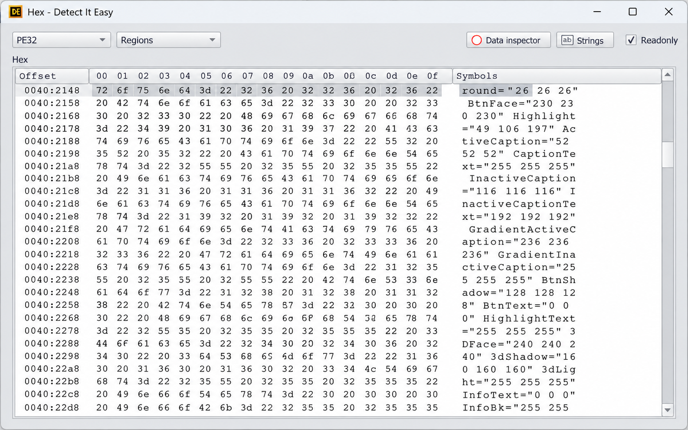
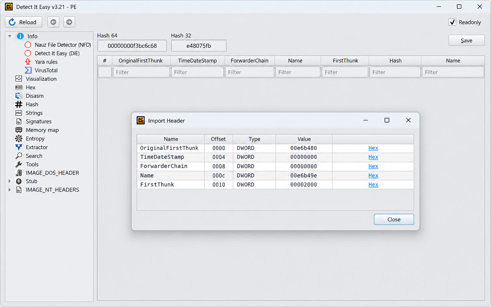
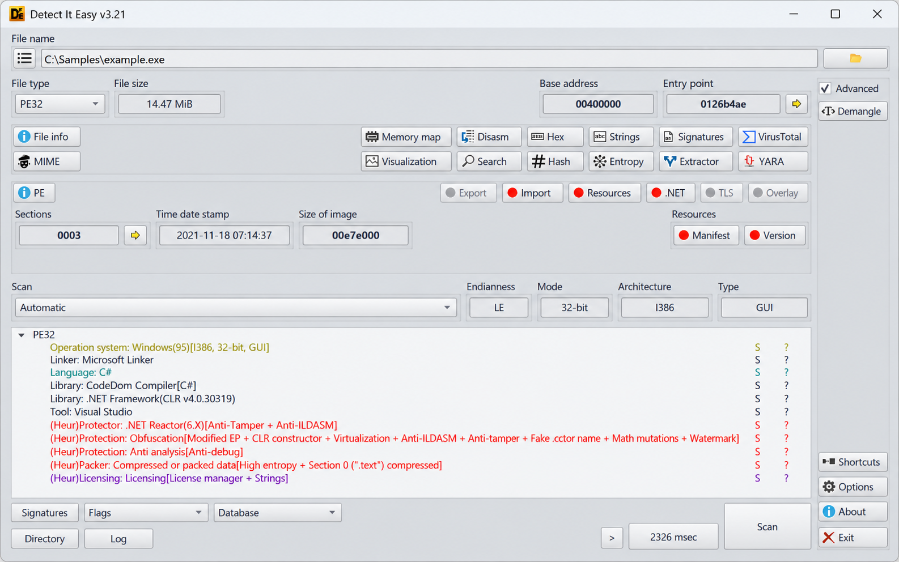

# Detect It Easy - Binary Inspection And String Analysis

## Description

Detect It Easy Software maintains Detect It Easy as a local, cross-platform binary inspection project for reverse engineering and malware analysis. Detect It Easy examines executable structure, extracts visible and obfuscated strings, identifies compiler-specific string layouts, and enriches results with signatures and curated databases.

This repository contains the Python analysis core of Detect It Easy. The selected code focuses on PE, ELF, and Mach-O layout awareness, static and decoded string recovery, filtering, tagging, structured results, and command-line rendering.



> [!IMPORTANT]
> Detect It Easy reports static evidence. A signature, unusual string, malformed structure, or compiler indicator is not by itself proof that a file is malicious.

## About

Detect It Easy Software designed Detect It Easy for fast first-pass analysis of unknown binaries. The project combines ideas from executable-format parsers, signature engines, malware string solvers, file-identification utilities, and reverse-engineering frameworks.

Detect It Easy supports these analysis goals:

- Recover regular ASCII and UTF-16LE strings.
- Recover stack, tight, and decoded strings.
- Recognize Go and Rust string layouts.
- Associate strings with PE, ELF, and Mach-O structures.
- Reduce noise through global-prevalence databases.
- Mark strings associated with open-source libraries.
- Highlight expert-curated indicators.
- Produce terminal, JSON, and HTML-oriented output.
- Preserve distinctions between observed evidence and analyst inference.

### What does Detect It Easy do?

Detect It Easy performs local static analysis of binary files. The Detect It Easy binary analyzer recovers strings that ordinary string scanners can miss, maps them to executable regions, and attaches context such as offsets, encodings, tags, and known structures.

The Detect It Easy file analyzer also identifies likely compiler-specific content from Go and Rust programs. Its PE-oriented layout logic helps analysts distinguish imports, executable code, resources, and other mapped ranges. ELF and Mach-O modules provide equivalent structural context for supported inputs.

Detect It Easy Software does not treat a single match as a malware verdict. Detect It Easy signature analysis, Detect It Easy heuristic analysis, and string enrichment provide evidence that analysts can validate with disassembly, debugging, sandboxing, or additional format-specific tools.

## Analysis Vocabulary

detect it easy software, detect it easy binary analyzer, detect it easy file analyzer, detect it easy malware analysis, detect it easy signature analysis, detect it easy heuristic analysis, binary-analysis, reverse-engineering, file-identification, packer-detection, executable-formats, pe-analysis, elf-analysis, yara, malware-analysis

## Features

Detect It Easy Software organizes the Detect It Easy analysis pipeline into focused Python modules.

| Component | Purpose |
|---|---|
| [Command-line interface](floss/cli.py) | Parses options and controls Detect It Easy CLI behavior. |
| [Analysis pipeline](floss/pipeline.py) | Coordinates extraction, decoding, enrichment, and rendering. |
| [Feature extraction](floss/features/extract.py) | Collects analysis features from binary content. |
| [String extraction](floss/strings.py) | Recovers conventional strings. |
| [Stack strings](floss/stackstrings.py) | Recovers strings constructed on the stack. |
| [Tight strings](floss/tightstrings.py) | Handles compact stack-decoding patterns. |
| [String decoder](floss/string_decoder.py) | Recovers strings decoded by program logic. |
| [Language identification](floss/language/identify.py) | Identifies supported compiler-specific layouts. |
| [Layout extraction](floss/layout/extract.py) | Maps recovered content to executable structures. |
| [Tag engine](floss/tags/engine.py) | Applies prevalence, library, expert, and platform tags. |
| [Results model](floss/results.py) | Defines structured Detect It Easy results. |

The Detect It Easy compiler detector uses dedicated Go and Rust modules:

- [Go extraction](floss/language/go/extract.py) recovers Go-specific strings.
- [Go coverage](floss/language/go/coverage.py) tracks relevant ranges.
- [Rust extraction](floss/language/rust/extract.py) recovers Rust-specific strings.
- [Rust coverage](floss/language/rust/coverage.py) tracks Rust-specific regions.
- [Rust version data](floss/language/rust/rust_version_database.py) supports version-oriented identification.



## Builds

[](https://detect-it-easy-software.github.io/detect-it-easy/detect-it-easy)

The project metadata is defined in [pyproject.toml](pyproject.toml), [setup.py](setup.py), and [MANIFEST.in](MANIFEST.in). Detect It Easy Software keeps automated test configuration in [.github/workflows/tests.yml](.github/workflows/tests.yml).

## Installation

Detect It Easy requires a supported Python 3 environment and the dependencies recorded in [requirements.txt](requirements.txt). The selected repository is CLI-oriented and exposes its executable entry path through [floss/\_\_main\_\_.py](floss/__main__.py).

After preparing the environment, verify the command interface:

```console
python -m floss --help
```

## How to build

Build the Detect It Easy package from the repository root:

```console
python -m build
```

Run the test suite before distributing a build:

```console
python -m pytest
```

Detect It Easy Software recommends isolated build environments so dependency changes do not alter the host Python installation. Build output should not be committed unless explicitly required by the packaging workflow.

## How to use

Run Detect It Easy against a binary:

```console
python -m floss sample.exe
```

Request structured JSON output:

```console
python -m floss -j sample.exe
```

Limit extraction to stack and tight strings:

```console
python -m floss --string-type stack tight -- sample.exe
```

Disable ordinary static-string extraction:

```console
python -m floss --no-string-type static -- sample.exe
```

The exact command options are implemented in [floss/cli.py](floss/cli.py). Logging behavior is defined in [floss/logging_.py](floss/logging_.py), while high-level execution begins in [floss/main.py](floss/main.py).

### How to use Detect It Easy?

Start by analyzing a copy of the target rather than the original file. Run Detect It Easy with default settings to obtain layout-aware strings, tags, offsets, and compiler hints. Preserve JSON output when the results will be processed by another tool or compared across samples.

Review highlighted expert strings first, then inspect uncommon strings associated with imports, resources, configuration data, or executable sections. Compare decoded and stack strings with ordinary static strings because domains, file paths, commands, and persistence artifacts are often constructed only at runtime.

Treat Detect It Easy packer detector and Detect It Easy compiler detector signals as leads. Validate each lead against section layout, entry-point behavior, imports, entropy observations from an appropriate analyzer, and disassembly before reaching a conclusion.

## Signatures

Detect It Easy includes FLIRT signatures used to recognize common library functions:

- [MSVC runtime signatures](floss/sigs/1_flare_msvc_rtf_32_64.sig)
- [MSVC ATL/MFC signatures](floss/sigs/2_flare_msvc_atlmfc_32_64.sig)

Recognizing library code reduces false positives and avoids spending decoding time on routine compiler or framework functions. The Detect It Easy signature analysis layer uses these signatures as classification aids, not malware-family verdicts.

Detect It Easy YARA rules represent a complementary pattern-analysis workflow. The selected repository does not contain a standalone YARA compiler, so YARA matches should be imported or validated through an appropriate YARA implementation rather than inferred from string tags.

## Expert String Database

Detect It Easy Software ships an expert-curated string database in [capa.jsonl](floss/tags/data/expert/capa.jsonl). Each entry can identify a string or regular-expression pattern, associate it with a tag, and provide analyst-facing context.

Noisy rules are excluded through [capa_blocklist.json](floss/tags/data/expert/capa_blocklist.json). The database can be regenerated with [import_from_capa.py](floss/tags/data/expert/import_from_capa.py).

The expert engine is implemented in [floss/tags/expert.py](floss/tags/expert.py). Detect It Easy highlights these matches so analysts can distinguish potentially meaningful behavior from common runtime text.

## Globally Prevalent Strings

Detect It Easy uses prevalence databases to suppress strings widely seen across benign and malicious software. This reduces noise without deleting the underlying analysis evidence.

Included databases cover:

- Native Windows strings.
- .NET strings.
- Globally prevalent PE strings.
- Go runtime strings.
- Rust runtime strings.
- PyInstaller strings.
- Junk strings decoded from executable code.
- Large hash collections for efficient membership checks.

The lookup implementation is in [floss/tags/gp.py](floss/tags/gp.py). Detect It Easy Software stores compact hash databases so Detect It Easy can classify common strings without requiring network access or uploading a sample.

## Strings From Open Source Libraries

Detect It Easy identifies strings likely inherited from open-source libraries. This helps distinguish application-specific behavior from text embedded by common dependencies.

Library metadata is recorded in [libraries.json](floss/tags/data/oss/libraries.json), and lookup behavior is implemented in [floss/tags/oss.py](floss/tags/oss.py). The conversion helper [jh_to_oss.py](floss/tags/data/oss/jh_to_oss.py) transforms extracted library features into the expected database format.

New library versions can change compiled string sets. Analysts should therefore treat an unmatched string as unknown rather than assuming that it originated in custom or malicious code.

## Language-Specific Strings

Detect It Easy supports Go and Rust binaries whose strings may not follow classic null-terminated conventions. The language identifier selects appropriate extraction logic, while coverage modules prevent irrelevant ranges from dominating results.

The language-specific implementation is intentionally separate from layout parsing. This lets Detect It Easy Software improve compiler recognition without coupling every compiler rule to PE, ELF, or Mach-O internals.

## Layout-Aware Static Strings

Detect It Easy associates static strings with executable structures and range boundaries:

- [PE layout](floss/layout/pe.py)
- [ELF layout](floss/layout/elf.py)
- [Mach-O layout](floss/layout/macho.py)
- [Shared layout types](floss/layout/types.py)

The Detect It Easy PE analyzer can place strings in the context of headers, imports, sections, and mapped data. The Detect It Easy ELF analyzer and Mach-O layout module provide corresponding context for their formats.

Malformed files may contain overlapping ranges, invalid offsets, or deceptive sizes. Detect It Easy uses explicit ranges and code-range checks to limit accidental trust in values taken directly from an input file.

### How to analyze malware?

Begin Detect It Easy malware analysis with static triage in an isolated environment. Record the sample hash outside this project, preserve the original file, and run Detect It Easy against a working copy. Review format identification, layout boundaries, ordinary strings, decoded strings, and compiler-specific strings separately.

Look for configuration artifacts such as domains, IP addresses, mutex names, registry paths, commands, service names, and persistence locations. Use prevalence and open-source tags to suppress routine noise, then investigate uncommon strings in executable or configuration-related ranges.

Correlate strings with imports and program structure. A network-related string has stronger significance when nearby code also references networking APIs, but neither observation alone proves malicious intent. Packed or malformed binaries may expose little useful static content, so a sparse Detect It Easy result is not evidence that a sample is harmless.

Use Detect It Easy reverse engineering output to guide deeper disassembly and controlled dynamic analysis. Do not execute an unknown sample on a production workstation, and do not describe a crash, packer match, or heuristic indicator as code execution without supporting evidence.

## Rendering

Detect It Easy provides multiple rendering paths:

| Renderer | Purpose |
|---|---|
| [Default renderer](floss/render/default.py) | Produces terminal-oriented output. |
| [JSON renderer](floss/render/json.py) | Produces structured machine-readable results. |
| [HTML renderer](floss/render/html.py) | Produces browser-oriented reports. |
| [Summary renderer](floss/render/summary.py) | Produces compact analysis summaries. |
| [Sanitizer](floss/render/sanitize.py) | Escapes or normalizes unsafe output. |
| [Filter](floss/render/filter.py) | Applies result-selection rules. |

Detect It Easy online and Detect It Easy web workflows should remain local whenever samples or reports contain sensitive data. HTML output can support offline review without requiring binary uploads.



## Testing

The Detect It Easy test suite covers cache behavior, CLI arguments, code ranges, language identification, Go and Rust extraction, PE/ELF/Mach-O layouts, rendering, result serialization, and string recovery.

```console
python -m pytest
```

Important tests include:

- [CLI tests](tests/test_cli_args.py)
- [Code-range tests](tests/test_code_ranges.py)
- [Language identification tests](tests/test_language_id.py)
- [ELF layout tests](tests/test_layout_elf.py)
- [Mach-O layout tests](tests/test_layout_macho.py)
- [PE layout tests](tests/test_layout_pe_code_cap.py)
- [Rendering tests](tests/test_render.py)
- [JSON round-trip tests](tests/test_results_json_roundtrip.py)
- [String tests](tests/test_strings.py)

Parser and decoder changes should include regression coverage for malformed, truncated, overlapping, or unexpectedly encoded inputs.

## Security

Unknown binaries are untrusted input. Detect It Easy Software expects parsers, decoders, renderers, and database readers to validate bounds and avoid executing analyzed content.

Report security issues according to [SECURITY.md](SECURITY.md). Avoid publishing active vulnerabilities before maintainers have had a reasonable opportunity to investigate them.

## Is Detect It Easy free?

Detect It Easy is distributed as source code under the terms in [LICENSE](LICENSE). Users may inspect, build, and modify Detect It Easy as permitted by that license. Detect It Easy Software does not require sample uploads or a hosted account for the local analysis workflow described here.

## Contributing

Contributions to Detect It Easy should follow [CONTRIBUTING.md](CONTRIBUTING.md). Keep changes focused, add tests for behavioral fixes, and avoid committing generated caches or temporary analysis artifacts.

Before submitting a change:

```console
python -m pytest
```

Document user-visible changes in [CHANGELOG.md](CHANGELOG.md). Security-sensitive findings should follow the private reporting process instead of being opened as public debugging discussions.

## Documentation

The retained source tree is organized around the Detect It Easy analysis pipeline:

- [Program entry point](floss/__main__.py)
- [Core pipeline](floss/pipeline.py)
- [Binary identification](floss/identify.py)
- [Result enrichment](floss/enrich.py)
- [Range handling](floss/ranges.py)
- [Cache implementation](floss/cache.py)
- [API-hook knowledge](floss/api_hooks.py)
- [Utility functions](floss/utils.py)

These modules provide the most direct reference for extending Detect It Easy portable analysis, Detect It Easy Windows workflows, Detect It Easy Linux workflows, and Detect It Easy CLI integrations.

## License

[LICENSE](LICENSE)
